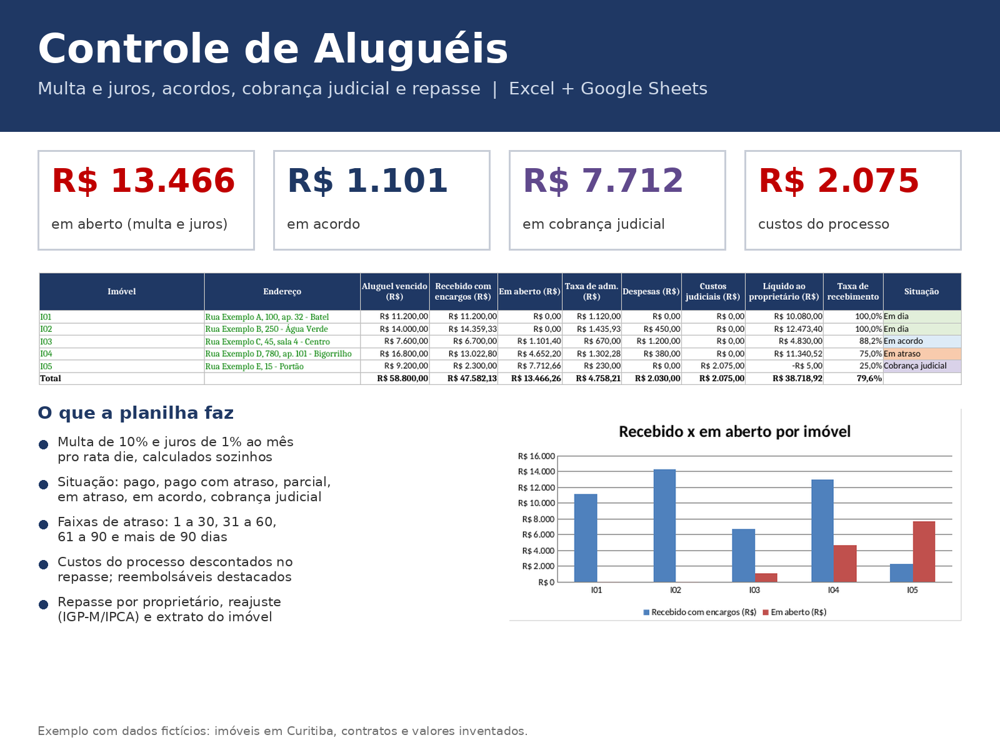
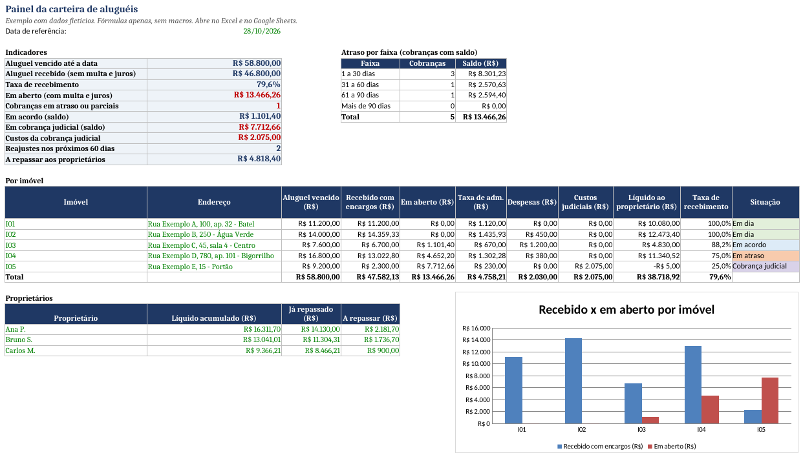
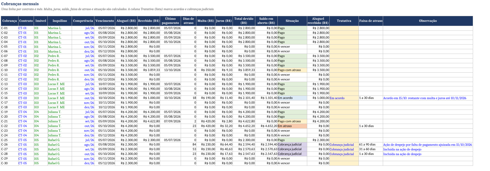
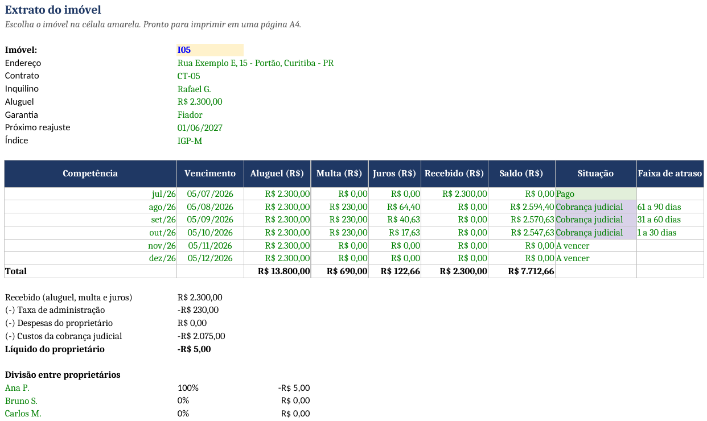

# Controle de Aluguéis (Excel / Google Sheets)

Planilha de administração de aluguéis para imobiliárias, administradores e proprietários no Brasil. Um único lançamento de recebimento atualiza multa, juros, situação de cada cobrança, taxa de administração, repasse a cada proprietário e o extrato do imóvel.

> Exemplo com dados fictícios. Imóveis em Curitiba, inquilinos, proprietários e valores são inventados.

## O que a planilha faz

- **Cobranças mensais:** uma linha por contrato e mês, com vencimento, dias de atraso, multa, juros, saldo em aberto e situação (Pago, Pago com atraso, Parcial, Em atraso, A vencer).
- **Acordos e cobrança judicial:** na coluna Tratativa, escolha "Em acordo" ou "Cobrança judicial"; enquanto houver saldo, a situação mostra a tratativa, com observação livre ao lado.
- **Faixas de atraso:** cada cobrança com saldo é classificada em 1 a 30, 31 a 60, 61 a 90 ou mais de 90 dias, com quantidade e saldo por faixa no Painel.
- **Custos do processo:** custas, honorários e diligências lançados na aba Cobrança judicial, indicando quem pagou e se podem ser pedidos ao inquilino; os pagos pelo proprietário são descontados no repasse.
- **Multa e juros:** multa de 10% sobre o aluguel e juros de mora de 1% ao mês pro rata die, contados do vencimento até o pagamento. Percentuais e dias de tolerância ficam na aba Parâmetros e devem seguir o contrato.
- **Painel:** aluguel vencido, recebido, taxa de recebimento, valor em aberto, saldo em acordo, saldo em cobrança judicial, custos do processo, reajustes próximos e total a repassar.
- **Repasse aos proprietários:** recebido menos taxa de administração, despesas e custos judiciais pagos em nome do proprietário, dividido conforme a participação de cada proprietário em cada imóvel.
- **Reajuste anual:** data do próximo reajuste pelo aniversário do contrato (IGP-M ou IPCA), com destaque para os que vencem em até 60 dias.
- **Extrato do imóvel:** escolha o imóvel numa lista e imprima ou envie em PDF, em uma página.

| Painel | Cobranças |
|---|---|
|  |  |

## Cenários do exemplo

| Imóvel | Situação em 28/10/2026 |
|---|---|
| I01 | Em dia |
| I02 | Pago com 8 dias de atraso, com multa de R$ 350,00 e juros de R$ 9,33 |
| I03 | Pagou R$ 1.000,00 e fez acordo para o restante: **Em acordo**, saldo de R$ 1.101,40 |
| I04 | Sem pagamento há 23 dias: **Em atraso**, R$ 4.652,20 com multa e juros |
| I05 | Sem pagamento desde agosto: **Cobrança judicial** (ação de despejo), saldo de R$ 7.712,66 e R$ 2.075,00 de custos do processo |

## Como usar

1. Baixe `Controle_Alugueis_Demo.xlsx`. Abre no Excel e, depois de enviada ao Google Drive, no Google Sheets.
2. Ao receber um aluguel, lance uma linha em **Recebimentos** com a data, o código da cobrança e o valor.
3. Veja o **Painel** e o **Extrato** se atualizarem.

A data de referência está fixa em 28/10/2026 para o exemplo. No uso real, troque por `=HOJE()` na aba Parâmetros.

Correção monetária não está incluída neste exemplo; pode ser acrescentada pelo índice do contrato.

## Como foi feita

Somente fórmulas (SOMASES, ÍNDICE/CORRESP, MÁXIMOSES), validação de dados e formatação condicional, sem macros. A planilha é gerada pelo script `scripts/gerar_planilha.py` (Python + openpyxl).

## Autor

Rodrigo Matoso: perito judicial avaliador de imóveis e corretor de imóveis no Paraná, com formação em Análise e Desenvolvimento de Sistemas.

## Licença

MIT
